<div align="center">


<h1>Fire Command Cockpit</h1>

<p><strong>A photoreal, real-time 3D fire dispatch console that runs in your browser.</strong></p>

<p>Sit down at Central Command. Seven live screens, two multi-function displays, a working joystick and button deck,<br>
a city full of units to dispatch, and a radio that never stops talking. <em>Every second counts.</em></p>

<p>
  <a href="https://abhinav-prabhakar.github.io/Cockpit/"></a>
  <a href="docs/media/tour.mp4"></a>
  <a href="https://github.com/Abhinav-Prabhakar/Cockpit/actions/workflows/pages.yml"></a>
  <a href="https://github.com/Abhinav-Prabhakar/Cockpit/stargazers"></a>
</p>

<p>
  
  
  
  
  
  
  
  
  
  
  
  
</p>

<a href="https://abhinav-prabhakar.github.io/Cockpit/">
  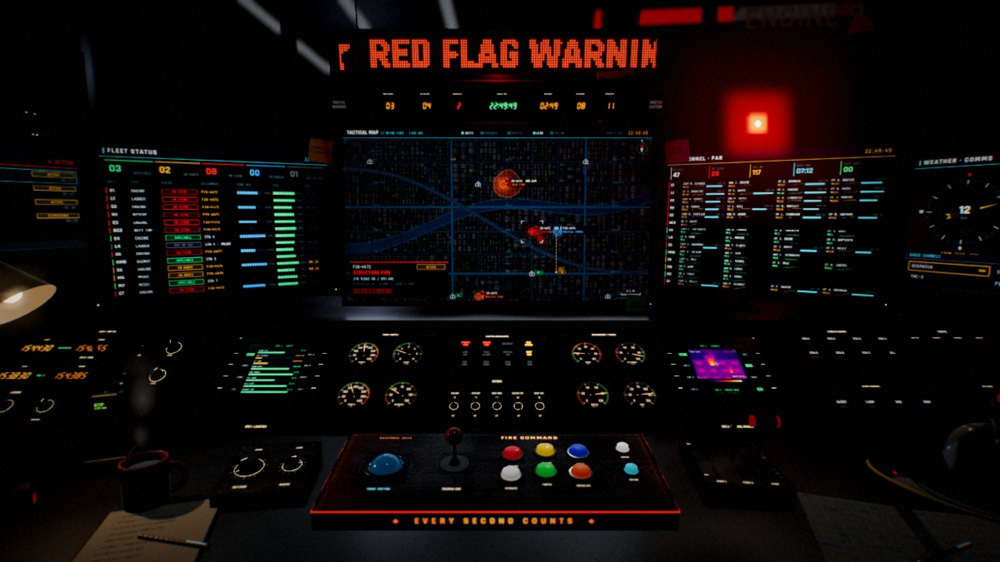
</a>

<sub><strong>This is a screenshot of the actual app, not a render.</strong> Every screen, gauge and light in it is live.</sub>

</div>

<p align="center">
  <a href="#the-room">The room</a> ·
  <a href="#the-screens">The screens</a> ·
  <a href="#the-mfds">MFDs</a> ·
  <a href="#the-response-deck">Response deck</a> ·
  <a href="#the-simulation">Simulation</a> ·
  <a href="#sound">Sound</a> ·
  <a href="#controls">Controls</a> ·
  <a href="#quickstart">Quickstart</a> ·
  <a href="docs/ARCHITECTURE.md">Architecture</a>
</p>

---

<a id="the-room"></a>

## The room

You are the dispatcher on console 01. It is late, the bay lights are low, and the city keeps calling. Look around, lean in, walk the desk, and double-click any screen to fly the camera right up to it.

<div align="center">
  <a href="docs/media/tour.mp4">
    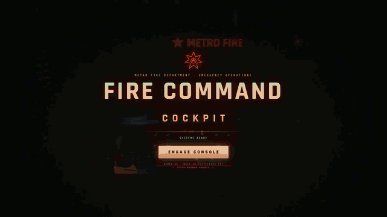
  </a>
  <br>
  <sub>A 19-second tour, from power-on to the thermal camera. <a href="docs/media/tour.mp4">Watch the full-quality MP4</a>.</sub>
</div>

<br>

Press <kbd>C</kbd> for cinema bars and the console becomes a 2.39:1 widescreen shot, with bloom, depth of field and real-time reflections doing the work.

<div align="center">
  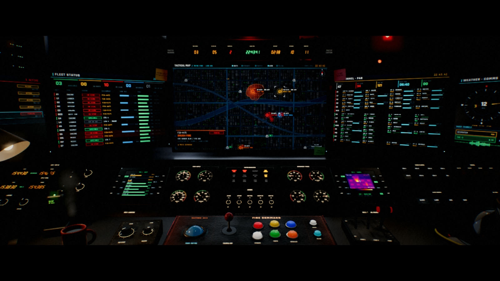
</div>

<br>

<a id="the-screens"></a>

## The screens

Seven displays, all driven by one shared simulation, so a dispatch on the map shows up in the fleet list, the CAD queue and the radio log at the same moment. Press <kbd>1</kbd> to <kbd>7</kbd> to jump to each.

### <kbd>1</kbd> Tactical map

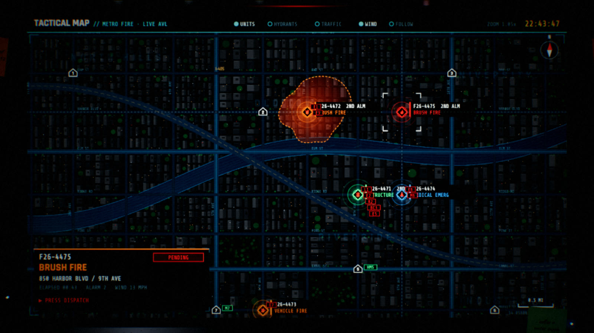

A live AVL map of a procedurally generated city. Incidents pulse with heat halos and are tagged with their alarm level and assigned apparatus. Units drive real routes along the street grid toward the scene, with ETA lines you can watch tick down.

- Layer toggles for **units**, **hydrants**, **traffic**, **wind** and **follow**
- Click an incident to select it, and the lower-left card shows address, elapsed time, alarm level, wind and the units assigned
- Station markers, compass, scale bar and zoom readout

<table>
  <tr>
    <td width="50%" valign="top">
      <b><kbd>2</kbd> Fleet status</b><br>
      <sub>Every unit's status chip (available, en route, on scene, returning, out of service), assignment, ETA and progress bars. Totals across the top.</sub><br><br>
      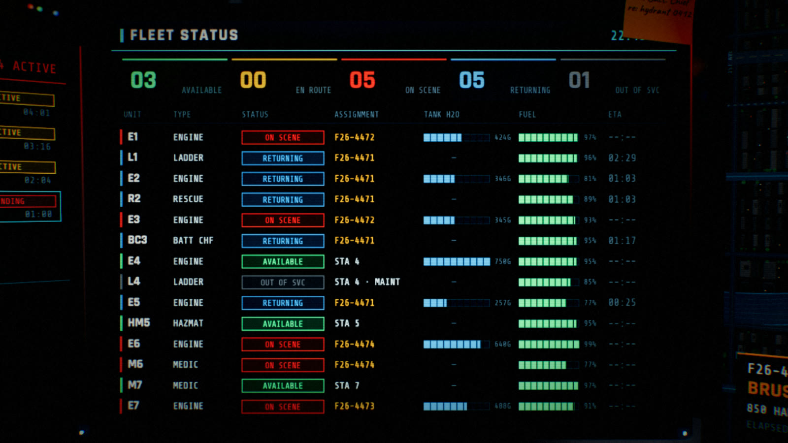
    </td>
    <td width="50%" valign="top">
      <b><kbd>3</kbd> Personnel accountability</b><br>
      <sub>A PAR board with a countdown timer. Every crew member, by rank and name, tracked per unit on scene.</sub><br><br>
      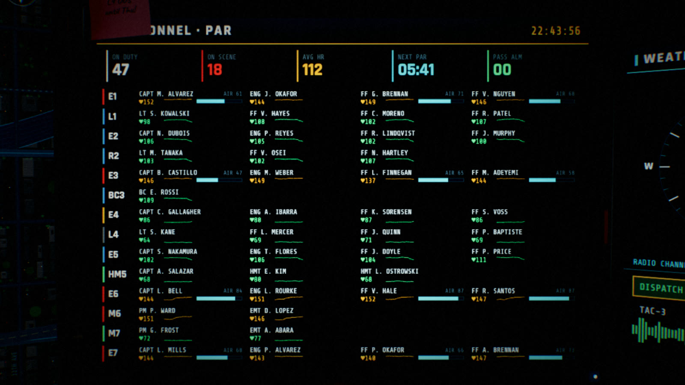
    </td>
  </tr>
  <tr>
    <td width="50%" valign="top">
      <b><kbd>4</kbd> CAD queue and radio log</b><br>
      <sub>Incoming calls waiting for a decision, and a scrolling transcript of everything said on the air.</sub><br><br>
      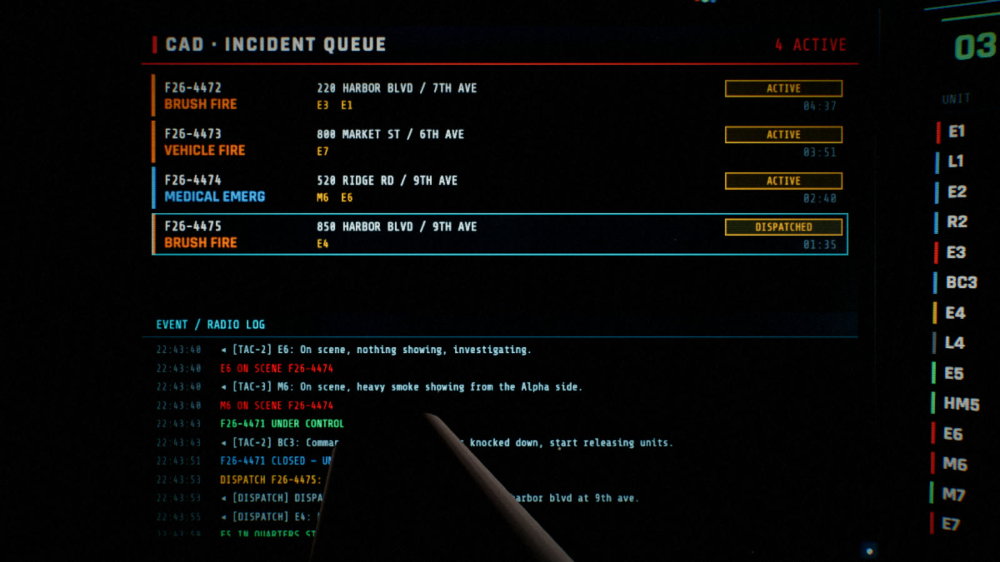
    </td>
    <td width="50%" valign="top">
      <b><kbd>5</kbd> Weather and comms</b><br>
      <sub>A wind compass with live speed, humidity and temperature, plus six selectable radio channels.</sub><br><br>
      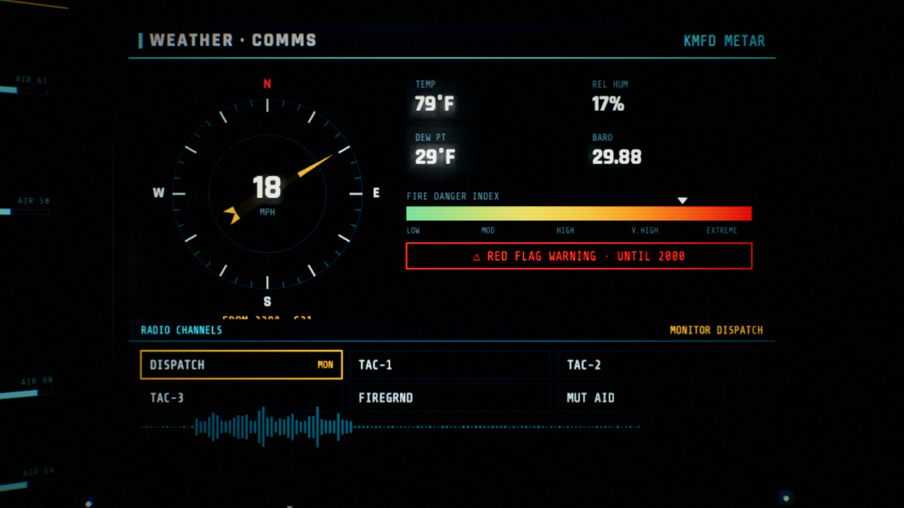
    </td>
  </tr>
</table>

<a id="the-mfds"></a>

## The MFDs

Two bezel-mounted multi-function displays, each with eight soft keys you can actually press. Press <kbd>6</kbd> or <kbd>7</kbd> to fly in.

<table>
  <tr>
    <td width="50%" valign="top">
      <b><kbd>6</kbd> MFD 1 · Logistics</b><br>
      <sub><code>EQUIP</code> <code>PUMP</code> <code>HYDR</code> <code>SYS</code> on the left; <code>ENG ▲</code> <code>ENG ▼</code> <code>RESET</code> <code>TEST</code> on the right. The equipment page tracks SCBA cylinders, attack and supply hose, foam, hydraulic tools, thermal cameras and ALS kits as live inventory bars.</sub><br><br>
      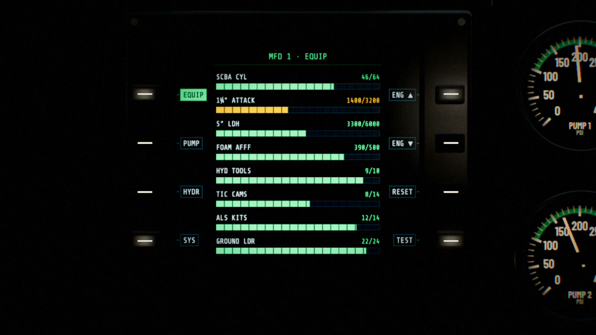
    </td>
    <td width="50%" valign="top">
      <b><kbd>7</kbd> MFD 2 · Thermal</b><br>
      <sub>Four thermal cameras with <code>WHT</code> <code>IRON</code> <code>RAIN</code> palettes and a <code>REC</code> key. Aim with the joystick and read spot and max temperature off the crosshair.</sub><br><br>
      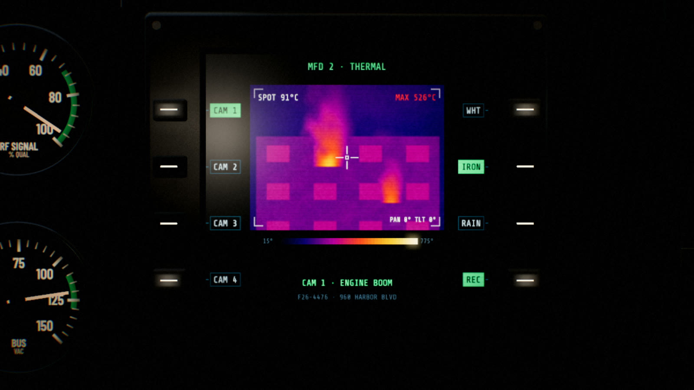
    </td>
  </tr>
</table>

<a id="the-response-deck"></a>

## The response deck

Below the screens sits a physical-feeling control surface: a trackball for panning the map, a joystick for the thermal camera, and a row of arcade buttons that toggle map layers and call for help. Gauges swing, annunciators light, toggles flip, and the bezel glows <code>EVERY SECOND COUNTS</code>.

<table>
  <tr>
    <td width="50%" valign="top">
      <b><kbd>8</kbd> Main panel</b><br>
      <sub>Two clusters of analogue gauges (pump pressure, hydrant, water, RF signal, bus voltage), a master annunciator grid (structure fire, brush fire, hazmat, low air, mutual aid...), a systems toggle row and a seven-segment clock strip.</sub><br><br>
      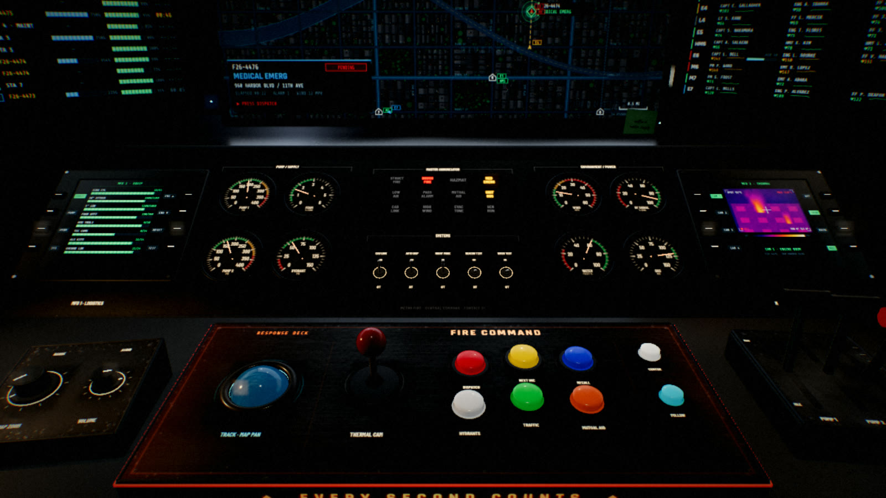
    </td>
    <td width="50%" valign="top">
      <b><kbd>9</kbd> Response deck</b><br>
      <sub>Trackball, joystick, and arcade buttons for dispatch, hydrants, traffic, mutual aid, centre and follow.</sub><br><br>
      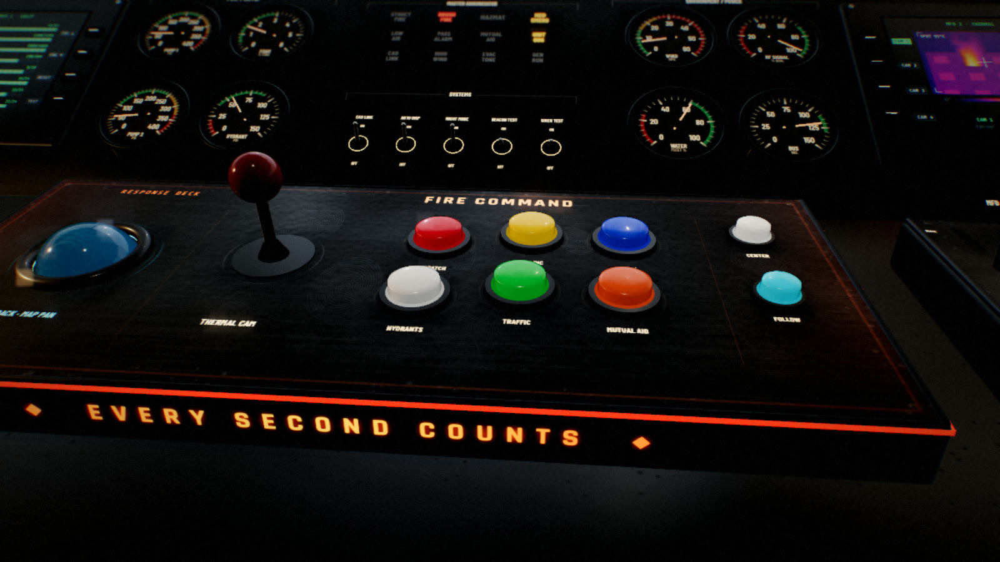
    </td>
  </tr>
</table>

<a id="the-simulation"></a>

## The simulation

The world is not a loop. It is a small dispatch simulation that keeps running whether or not you touch anything.

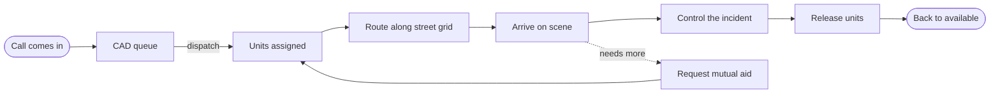

| Incident | Code | Apparatus it needs |
|:--|:--|:--|
| Structure fire | `STR` | 2 engines, 1 ladder, battalion chief, rescue (2nd alarm) |
| Vehicle fire | `VEH` | 1 engine |
| Brush fire | `BRU` | 2 engines, battalion chief (2nd alarm) |
| Hazmat leak | `HAZ` | hazmat, 1 engine |
| Medical emergency | `MED` | medic, 1 engine |
| MVA entrapment | `MVA` | rescue, engine, medic |
| Alarm activation | `ALM` | engine, ladder |

Fleet, personnel, map, CAD and weather all read from one `Sim`, so nothing can disagree with anything else. See [the architecture notes](docs/ARCHITECTURE.md#the-simulation).

<a id="sound"></a>

## Sound

There are zero audio files in this repo. Everything is synthesised with the Web Audio API at runtime:

- 🌫️ brown-noise **room tone** with 60/120/180 Hz mains hum and a breath of HVAC
- 🔘 **panel clicks** for every switch, key and button
- 🚨 **station alert tones** when units are toned out
- 📻 **radio chatter** through a high-passed, low-passed and soft-clipped bus so it sounds like it came out of a handheld

Press <kbd>M</kbd> to mute.

## What makes it look this way

| | |
|:--|:--|
| **Depth of field** | A custom gather-based DOF pass with bokeh-weighted highlights, so the far monitors melt away when you lean in |
| **Bloom** | `UnrealBloomPass` makes the LED ticker, red alert strip and screens glow into the room |
| **Area lights** | `RectAreaLight`s throw monitor-coloured spill onto the desk |
| **Live reflections** | The scene captures its own environment map so glass and brushed metal reflect the room, and recaptures when you change the lights |
| **Procedural materials** | Grime, scratches, brushed metal and panel paint are all drawn to canvas at startup |
| **Seat sway** | The camera has a slow, breathing drift so the shot is never dead still |
| **Cinema bars** | <kbd>C</kbd> drops a 2.39:1 letterbox for the hero shot |

<a id="controls"></a>

## Controls

| Input | Action |
|:--|:--|
| <kbd>W</kbd> <kbd>A</kbd> <kbd>S</kbd> <kbd>D</kbd> | Move around the room |
| <kbd>Q</kbd> / <kbd>E</kbd> | Down / up |
| Drag, or <kbd>←</kbd> <kbd>↑</kbd> <kbd>↓</kbd> <kbd>→</kbd> | Look |
| <kbd>Shift</kbd> | Move and look faster |
| Scroll | Zoom field of view, or lean in; over a knob it turns the knob |
| Double-click a screen | Fly to it |
| <kbd>1</kbd> – <kbd>9</kbd> | Jump to a view (map, fleet, personnel, CAD, weather, MFD 1, MFD 2, main panel, response deck) |
| <kbd>Esc</kbd> or right-click | Return to the seat |
| <kbd>[</kbd> <kbd>]</kbd> | Room and desk light down / up |
| <kbd>Shift</kbd>+<kbd>[</kbd> <kbd>]</kbd> | Control backlight down / up |
| <kbd>\</kbd> | Reset all lighting |
| <kbd>C</kbd> | Cinema bars |
| <kbd>M</kbd> | Mute |
| <kbd>H</kbd> | Hide the HUD |
| <kbd>F</kbd> | Fullscreen |

Click and drag any knob, button, switch or joystick. Hover over one for a tooltip.

<a id="quickstart"></a>

## Quickstart

There is no build step. Serve the folder over HTTP (ES modules will not load from `file://`) and open it.

```bash
git clone https://github.com/Abhinav-Prabhakar/Cockpit.git
cd Cockpit
python3 serve.py        # http://localhost:8791, caching off so edits show on reload
```

Any static server works just as well:

```bash
npx serve .
```

You need a browser with WebGL 2 and a GPU that can handle a few post-processing passes. Fullscreen on a laptop with a discrete or Apple Silicon GPU is the sweet spot.

### URL flags

| Flag | Effect |
|:--|:--|
| `?auto` | Skip the **Engage Console** button |
| `?auto&view=1` | Open straight onto a screen (`1`–`9`) |
| `?auto&fast` | Also skip the intro and all boot animations |

Open the console and poke at `window.__cockpit` (`sim`, `cam`, `VIEWS`, `screens`, `renderer`...) to drive it from DevTools.

## Project layout

```
index.html           intro overlay, HUD, import map
css/style.css        HUD, letterbox, tooltips
js/main.js           renderer, lights, camera, input, post chain
js/screens.js        Sim + every display
js/props.js          the physical console
js/backdrop.js       the bay behind the glass
js/textures.js       procedural canvases
js/audio.js          Web Audio synth
js/dof.js            depth of field
js/merge.js          mesh merging
serve.py             no-cache static dev server
```

About 3,500 lines of hand-written JavaScript, no dependencies beyond Three.js, which loads from a CDN. The deep dive is in [docs/ARCHITECTURE.md](docs/ARCHITECTURE.md).

## Deploying

Pushing to `main` runs [`.github/workflows/pages.yml`](.github/workflows/pages.yml), which stages the static files and publishes them with GitHub Pages. Fork it, enable **Settings → Pages → Source: GitHub Actions**, and you have your own console.

## Notes

- All names, units, addresses and incidents are fictional. "Metro Fire" is an invented department.
- Fonts (Barlow Condensed, Rajdhani, Share Tech Mono, Caveat, Permanent Marker) load from Google Fonts, and Three.js loads from jsDelivr, so the first load needs a connection.
- The first frame takes a moment while procedural textures and shadows are built.

## License

[MIT](LICENSE) © Abhinav Prabhakar

<div align="center">
<br>
<sub><strong>EVERY SECOND COUNTS</strong></sub>
<br><br>

</div>
